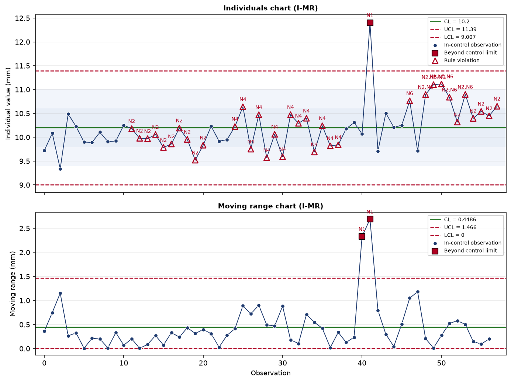
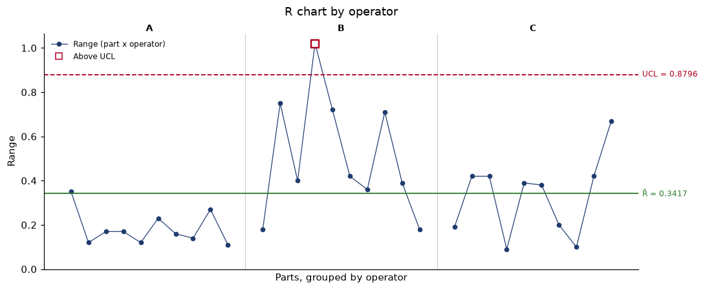

# SPC / Process Capability Analyzer

[](https://spc-analyzer.streamlit.app/)
[](https://github.com/DailyDana/process-capability-analyzer/actions/workflows/ci.yml)
[](https://www.python.org/downloads/)
[](LICENSE)

**[Try it live -> spc-analyzer.streamlit.app](https://spc-analyzer.streamlit.app/)** — no install. The Gage R&R
page opens on the AIAG reference study and reproduces Minitab's published results
without any input.

Free, open-source statistics for the three questions a supplier answers before
shipping a new part: **is the gauge good enough** (Gage R&R), **is the process
stable** (SPC charts), and **is it capable** (Cp/Cpk vs Pp/Ppk). Every method is
checked against published results, and every output is a **defensible
engineering statement**, not just a chart:

> *"Cpk = 1.09 from within-subgroup sigma, but the individuals chart shows an
> N1 outlier and an N2 run — this Cpk is not trustworthy evidence of future
> performance until the process is stabilized."*

It is intended for quality/manufacturing/process engineers who need SPC charts,
Cp/Cpk vs Pp/Ppk analysis, stability assessment, and audit-ready reports from
production measurement data.

## Key features

- **Gage R&R (crossed):** ANOVA (random-effects F tests, interaction pooled at
  p > 0.25 by convention) and the AIAG Average & Range method. Reports EV, AV,
  interaction, GRR, PV, %Contribution, %Study Var, %Tolerance (k = 6 or 5.15) and
  ndc. A range chart checks repeat readings **before** anything is concluded.
  Verified to the published decimal against Minitab, SAS and BPI analyses of
  two reference studies.
- **Control charts:** X̄–R, X̄–S, and I–MR with proper 3σ limits from the
  published control-chart constants (never plain ±3·stdev of the plotted data).
- **Run-rule engine:** full **Western Electric** (4 rules) and **Nelson**
  (8 rules) sets, kept distinct (WE4 = 8-in-a-row ≠ Nelson N2 = 9-in-a-row),
  with structured violations: rule ID, name, affected observations, direction,
  explanation. Overlapping violations are preserved.
- **Capability vs performance, never interchanged:** Cp/Cpk from
  **within-subgroup** sigma (R̄/d₂, S̄/c₄, pooled, or MR̄/d₂ by regime);
  Pp/Ppk from **overall** sigma. One-sided specifications handled correctly
  (no fake Cp/Pp).
- **Stability before capability:** SPC rules are evaluated first, and every
  capability result carries the stability verdict. A high Cpk on an unstable
  process is explicitly caveated, never silently reported as "capable".
- **Sigma level / DPMO** (Z-bench from the normal model; the 1.5σ shift is an
  opt-in, clearly-labeled convention).
- **Cpk confidence interval** (Bissell 1990 / Montgomery approximation, flagged
  as approximate, with its assumptions attached).
- **Deterministic interpretation engine** — rule-based, reproducible, no LLM:
  statistical conclusions (facts) strictly separated from engineering
  recommendations (advice), each with a stable trigger code and severity.
- **Reliability guards:** small-sample, few-subgroups, zero-variation,
  non-normality (Shapiro–Wilk + Anderson–Darling), and instability warnings —
  advisory, never suppressing the numbers.
- **Reporting:** full-precision CSV, 7-sheet Excel workbook, professional PDF
  report with embedded charts, plus PNG/SVG chart export.
- **Streamlit UI** with data import (CSV/Excel/manual), cleaning transparency
  (every excluded row listed with its reason), and configurable thresholds.



## PPAP scenario: the gauge first, then the process

A supplier launching a part for an automotive customer must show, for every
critical characteristic, that the measurement system is adequate **and** that the
process is capable. The order matters. A capability study run with an unproven
gauge measures the gauge as much as the process. The usual bar is a Gage R&R
under 10% (10-30% only with customer approval) followed by an initial process
study with Ppk of at least 1.67. Customer-specific requirements take precedence.

The AIAG reference study, opened by default on the Gage R&R page, shows what
the tool does with a gauge that is not ready:

1. **Repeat readings first.** The range chart flags appraiser B on part 4
   (0.01, 1.03, 0.20 → R = 1.02, above the UCL of 0.88). Every figure below is
   reported with that caveat until the cell is explained or re-measured.
2. **Verdict.** GRR is 27.9% of study variation and 22.7% of the tolerance: *may
   be acceptable depending on the application*. ndc = 4 (< 5): the gauge cannot
   reliably tell these parts apart.
3. **Where the variation comes from.** Repeatability (18.4%) and
   reproducibility (20.9%) are comparable, so the recommendation is to work on
   the gauge set-up and the measurement method together. The interaction plot
   shows where to start on the method: appraiser C reads lowest on all ten
   parts (average −0.25 against +0.19 for A).

Only once the study passes does the tool recommend proceeding to the capability
study on the other page.



## Architecture

```
Data input (CSV / Excel / manual)
        ↓
app/data        validation & cleaning (per-row records, nothing silently dropped)
        ↓
app/statistics  descriptive stats · control-chart constants · sigma estimators
        ↓
app/spc         control limits (X̄–R, X̄–S, I–MR) · WE/Nelson rule engine
        ↓
app/capability  Cp/Cpk (within σ) · Pp/Ppk (overall σ) · guards · Cpk CI
app/msa         Gage R&R: ANOVA · Average & Range · range check · ndc
        ↓
app/interpret   deterministic conclusions ⟂ recommendations
        ↓
app/reporting   CSV · Excel · PDF serialization (no statistics recomputed)
        ↓
app/ui          Streamlit presentation (thin; calls app/services only)
```

Dependencies point **downward only**. The statistical core (`data`,
`statistics`, `spc`, `capability`, `msa`, `interpret`) is pure Python with no UI or
I/O dependency and is fully unit-tested. `app/services` orchestrates the
sequence-of-analysis (validate → charts → **stability first** → sigma →
capability → interpretation); `app/charts` renders validated results without
recalculating them; `app/reporting` serializes without recomputing. Each layer
has exactly one source of truth: limits come from `app/spc`, capability from
`app/capability`, charts from `app/charts`, interpretation from
`app/interpret`.

The complete statistical methodology — every formula, constant, assumption,
convention, and reference — is documented in
[`docs/FORMULAS.md`](docs/FORMULAS.md).

## Installation

Requires **Python 3.10+**. On Windows (PowerShell or git-bash):

```bash
git clone <repository-url> spc-analyzer
cd spc-analyzer

# Create and activate a virtual environment
python -m venv .venv
source .venv/Scripts/activate        # git-bash
# .venv\Scripts\Activate.ps1         # PowerShell
# source .venv/bin/activate          # Linux/macOS

# Install dependencies
pip install -r requirements.txt
```

Run the application:

```bash
streamlit run app/ui/streamlit_app.py
```

The app opens at `http://localhost:8501`.

## Usage

A typical analysis session:

1. **Upload measurements** (section 1) — CSV/Excel file or manual entry; select
   the measurement column. The cleaning summary shows exactly how many rows are
   usable and why any were excluded.
2. **Enter specifications** (section 2) — USL and/or LSL, optional nominal,
   measurement unit, and traceability metadata (characteristic, part, machine,
   operator).
3. **Select the SPC chart** (sidebar) — X̄–R, X̄–S, or I–MR, subgroup size,
   rule set (Nelson / Western Electric / both), and within-σ estimator.
4. **Review stability** (section 5) — control charts with CL/UCL/LCL, flagged
   out-of-control points, and the violations table.
5. **Review capability** (section 6) — Cp/Cpk (within) beside Pp/Ppk (overall),
   sigma level, DPMO, the Cpk confidence interval, and all reliability
   warnings.
6. **Review the interpretation** (section 7) — factual statistical conclusions
   and, separately, engineering recommendations with their triggers.
7. **Export** (section 8) — CSV, Excel, PDF report, or PNG/SVG charts.

For a **Gage R&R** study, switch to the *Gage R&R (MSA)* page. Upload a long-format
file with one row per reading (part, operator, measurement, optional trial),
choose the method, and optionally enter the tolerance. A missing reading is
reported by row rather than dropped, because a crossed study must be balanced.
Results export to CSV and Excel.

## Example

### Verification against published results

`examples/pistonrings.csv` holds 200 real piston-ring diameter measurements
(40 samples of 5) from an automotive forging process, taken from the `qcc`
package and originally published as Montgomery's worked X-bar/R example. Because
the reference results are published, the dataset doubles as an end-to-end check
on this implementation. Analyzed as X-bar/R with subgroup size 5:

| quantity     | published | this application |
|--------------|-----------|------------------|
| x-bar-bar    | 74.001    | 74.00118         |
| R-bar        | 0.023     | 0.02276          |
| UCL (X-bar)  | 74.014    | 74.01431         |
| LCL (X-bar)  | 73.988    | 73.98804         |

Phase I (samples 1-25) is reported stable with no rule violations, Cp 1.70 /
Cpk 1.66; including the Phase II samples the drift is caught as N1/N5/N6 and the
capability verdict is caveated accordingly. See
[`examples/DATASETS.md`](examples/DATASETS.md).

### Gage R&R verification against published results

Two reference studies ship in `examples/`, each with independently published
analyses ([`examples/DATASETS.md`](examples/DATASETS.md)):

| study | published analysis | what matches |
|---|---|---|
| AIAG MSA 4th ed. example (10 parts × 3 appraisers × 3 trials) | Minitab, *Example of Crossed Gage R&R Study* | every ANOVA SS/MS/F/p in both models; every variance component, %Contribution, %Study Var and %Tolerance; ndc = 4 |
| same | BPI Consulting (2015), Average & Range | EV 0.202, AV 0.230, GRR 0.306, PV 1.105, TV 1.146, %GRR 26.68 |
| Houf & Burman (1988), thermal impedance | SAS/STAT PROC VARCOMP Example 121.2 | all four variance components, GRR, precision-to-tolerance 0.20145 |

The ANOVA is additionally checked against statsmodels on simulated studies, and
a Monte Carlo test checks that the variance-component estimators are unbiased.

### Synthetic rule-engine example

The repository also ships `examples/sample_measurements.csv` (58 observations:
a stable process seeded with one gross outlier and a sustained shift at the
end). Analyzed as I–MR with USL = 11.5, LSL = 8.5 (mm), the application
reports:

- **Stability:** UNSTABLE — rules N1, N2, N4, N5, N6 triggered (the outlier and
  the tail shift are both caught).
- **Capability:** Cpk ≈ 1.09 (within), Ppk ≈ 0.88 (overall) — reported but
  explicitly caveated as unreliable while the process is out of control.
- **Headline:** *"Process is statistically UNSTABLE; capability indices are
  retained but are not reliable evidence of future performance until the
  process is brought into control."*

The chart image above is the actual output for this dataset.

## Testing

```bash
python -m pytest
```

The suite currently contains **890 tests** (all passing, on Python 3.10 / 3.11 / 3.12 in CI), covering:

- known-answer verification of every statistic against independently
  hand-computed values (constants are additionally cross-validated against
  their exact mathematical definitions),
- every WE/Nelson rule triggered by crafted deterministic sequences,
- the Cp/Cpk-vs-Pp/Ppk separation (including a test proving Pp/Ppk cannot be
  affected by the within-subgroup sigma),
- edge cases: missing/non-numeric values, duplicates, tiny samples, zero
  variation, one-sided and invalid specifications,
- chart-model fidelity (rendered values bit-identical to the calculators),
- interpretation scenarios asserting on structured codes, not prose,
- full-pipeline integration tests (CSV → analysis → interpretation → CSV/Excel/
  PDF), with PDF content verified by text extraction,
- Gage R&R against two published studies (Minitab, SAS, BPI), an independent
  ANOVA implementation (statsmodels, stored as fixtures), a hand-computed study
  and a Monte Carlo unbiasedness check,
- execution of the real Streamlit pages via Streamlit's `AppTest` harness.

Code-coverage percentages are not claimed because coverage is not currently
measured.

## Statistical disclaimer

- **Stability and capability are different questions.** SPC control charts ask
  *"is the process statistically stable/predictable?"*; capability indices ask
  *"can the stable process meet the specification?"*. An unstable process
  should **not** be treated as reliably capable regardless of its Cpk.
- Capability indices assume the relevant statistical conditions —
  approximately normal data, rational subgrouping, and statistical control.
  The application tests and warns about these assumptions but cannot make an
  invalid assumption true.
- Capability thresholds (e.g. Cpk ≥ 1.33 "capable") are **engineering
  conventions** that vary by industry and customer standard; they are
  configurable in the app and are not universal statistical laws.
- The Cpk confidence interval is a large-sample approximation and is not exact.
- Gage R&R covers **crossed, balanced studies of variable data** only. Attribute
  agreement, nested designs, linearity and bias studies are not implemented. The
  %GRR bands (10% / 30%) and ndc ≥ 5 are AIAG conventions, configurable in the
  app, and are applied to %Study Var, not %Contribution.
- This software is an engineering analysis aid. It does **not** replace
  professional engineering judgment or customer-specific quality requirements.

## License

Apache License 2.0 — see [LICENSE](LICENSE) and [NOTICE](NOTICE).

Apache 2.0 was chosen over MIT deliberately: it carries an explicit patent
grant (§3) and a fuller warranty/liability disclaimer (§§7–8), which matter
for a tool whose output informs manufacturing quality decisions. Every
runtime dependency is permissively licensed (BSD / MIT / PSF / Apache-2.0),
so there is no copyleft obligation.

## References

Montgomery, D.C., *Introduction to Statistical Quality Control*, 7th ed.
(Wiley, 2013) · AIAG, *Statistical Process Control Reference Manual*, 2nd ed.
(2005) · NIST/SEMATECH *e-Handbook of Statistical Methods*, §6 · David &
Nagaraja, *Order Statistics*, 3rd ed. (Wiley, 2003) · Bissell, A.F., "How
reliable is your capability index?", *Applied Statistics* 39(3), 1990 · ASTM,
*Manual on Presentation of Data and Control Chart Analysis* (STP-15D) · AIAG,
*Measurement Systems Analysis Reference Manual*, 4th ed. (2010) · Burdick,
Borror & Montgomery, *Design and Analysis of Gauge R&R Studies* (ASA-SIAM, 2005).
Per-formula citations: [`docs/FORMULAS.md`](docs/FORMULAS.md).
